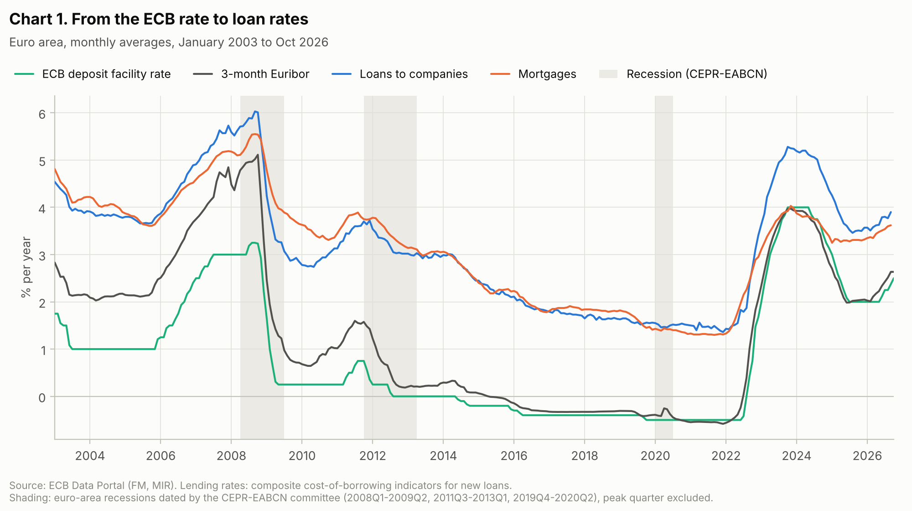
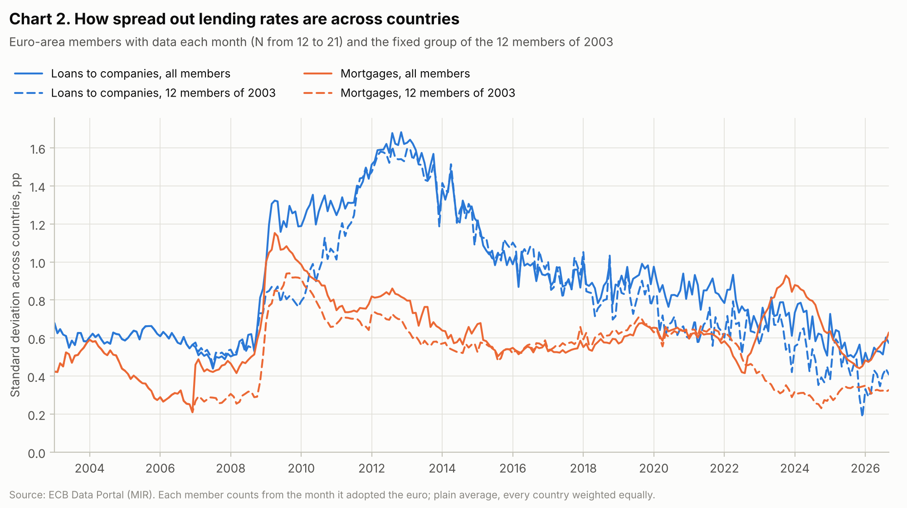
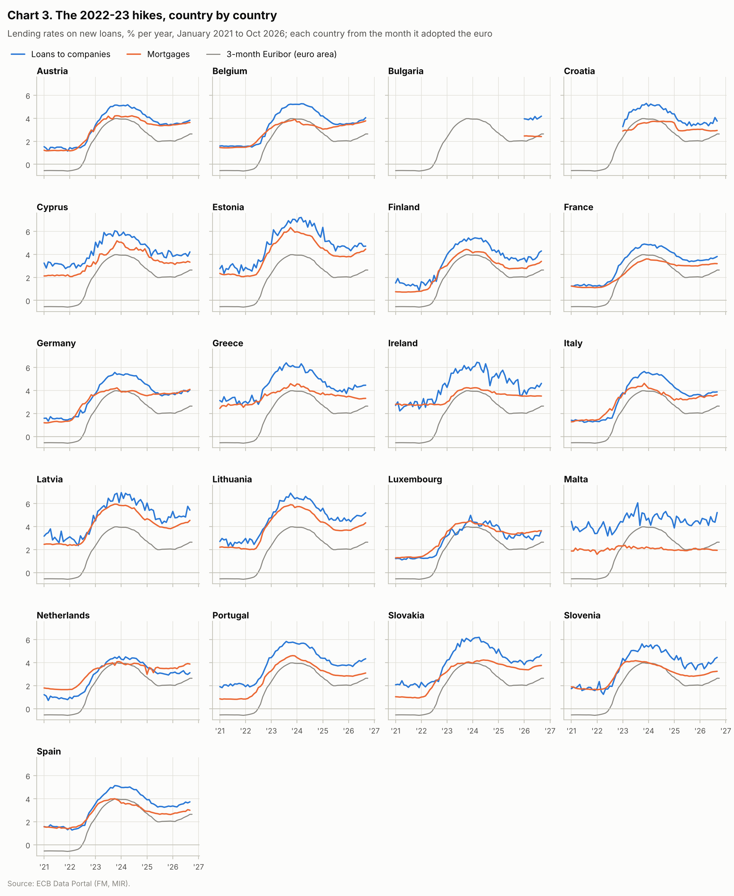
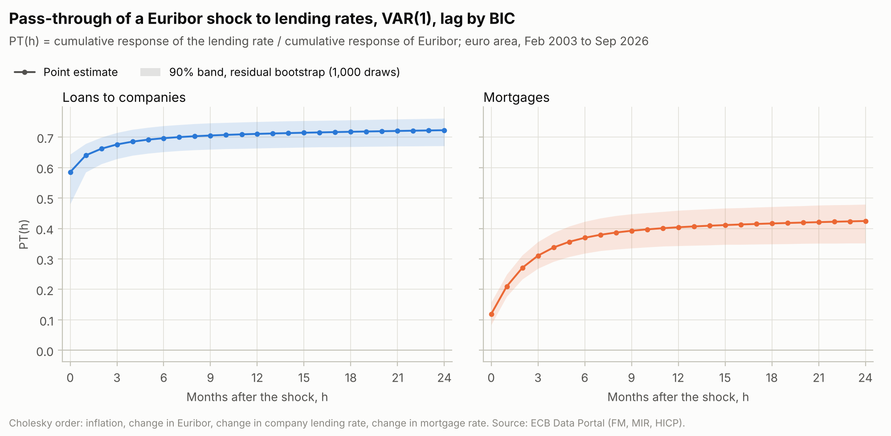
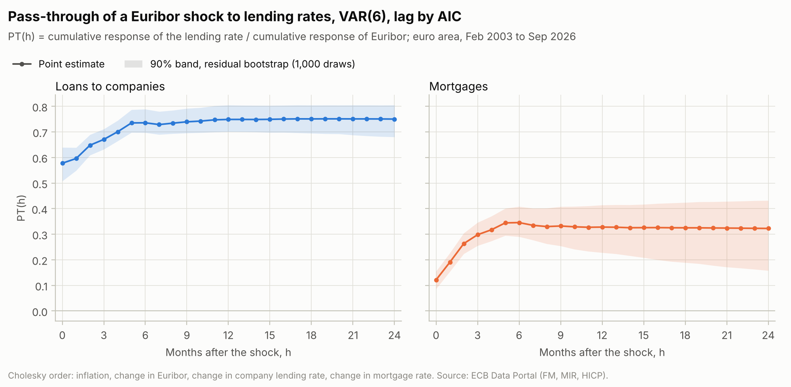

# Interest-rate pass-through in the euro area, 2003–2026

*How much of a move in market interest rates reaches the rates banks charge companies and families, how fast, and is it the same in every euro-area country?*

A small project on public ECB data.

---

## 1. The story, in simple words

**Interest rates are prices.** An interest rate is the price of borrowing money: borrow 100 € for a year at 3% and you pay back 103 €.

**There is a chain of prices:**

1. **The ECB rate.** The European Central Bank (ECB) is the "bank of the banks". It sets the rate banks earn when they park money with it (the *deposit facility rate*). It works roughly as a floor for very short-term market rates: a bank that can deposit at the ECB has no reason to lend overnight to another bank for less.
2. **Euribor.** The rate at which banks lend to each other, here for 3 months. It follows the ECB rate, plus a small premium for the risk of lending to another bank. Because the loan lasts 3 months, it also reflects where markets expect the ECB rate to go over those 3 months: in the first half of 2022, 3-month Euribor was already rising, months before the ECB's first hike in July 2022. Think of it as the *wholesale* price of money.
3. **Lending rates.** The rate a bank charges *you*, or a company, for a loan. Think of it as the *retail* price: roughly Euribor plus the bank's markup (risk, costs, profit).

**Why the ECB cares.** The ECB raises rates to fight inflation and cuts them to support the economy. That only works if the change travels down the chain to the loans people actually pay. If the ECB raises rates and loan rates don't move, nothing changes in the real economy.

**Pass-through** is how much of a move in Euribor reaches lending rates. If Euribor rises by 4 percentage points and loan rates rise by 3, pass-through is 3 ÷ 4 = 75%.

**Why countries can differ.** Euribor is the same number everywhere in the euro area, but banks aren't the same everywhere:
- Banks in countries that investors see as risky pay more for their own funding, so they charge more for loans.
- In some countries most mortgages are variable-rate (they follow Euribor quickly). In others they're fixed for years (they barely move for existing loans, and new fixed-rate loans follow long-term rates more than Euribor).
- Competition between banks differs across countries.

**The episode we look at.** Euro-area inflation peaked at 10.6% in October 2022. Between July 2022 and September 2023 the ECB raised its deposit rate ten times in a row, from −0.50% to 4.00%: 450 basis points, the sharpest tightening since the euro started in 1999. We measure how loan rates in each country followed.

**The four steps of the project:**
1. Download and store the data (Section 3).
2. Draw the facts (Section 4).
3. Measure pass-through in the 2022–23 episode, country by country, with plain arithmetic (Section 5).
4. Measure how lending rates react over time to a Euribor move with a model, the VAR, and how uncertain that answer is (Section 6).

---

## 2. Notation used everywhere

**Indices**
- $i$: a country (Italy, Germany, …).
- $t$: a month. $t-1$ is the month before, $t+1$ the month after.
- $h$: a number of months after something happens (the *horizon*): $h = 0$ is the same month, $h = 1$ the month after, and so on.

**Units.** All rates are in % per year. A change from 2% to 3% is a change of 1 *percentage point* (pp). One *basis point* (bp) is 0.01 pp.

**The monthly change of a series.** For any series, the Greek letter $\Delta$ ("delta") means "this month minus last month". For example:

$$\Delta r_t = r_t - r_{t-1}$$

If Euribor was 2.0% last month and 2.25% this month, then $\Delta r_t = 0.25$ pp.

**The data series**

| Symbol | Meaning |
|---|---|
| $r_t$ | 3-month Euribor in month $t$ (monthly average) |
| $L^{\text{NFC}}_{i,t}$ | rate on new loans to companies in country $i$, month $t$ (NFC = non-financial corporations) |
| $L^{\text{HH}}_{i,t}$ | rate on new loans to households for house purchase (mortgages) in country $i$, month $t$ (HH = households) |
| $L^{\text{NFC}}_t$, $L^{\text{HH}}_t$ | the same two rates for the euro area as a whole (no $i$) |
| $L_{i,t}$ | either of the two, when a formula applies to both: then compute it once for company loans and once for mortgages |
| $\pi_t$ | euro-area inflation in month $t$: % change of consumer prices over the last 12 months |
| $N_t$ | number of euro-area countries with data in month $t$ (it grows as countries join the euro) |
| $T$ | number of months in the sample (about 280) |

The lending rates are the ECB's *composite cost-of-borrowing indicators*. For each country and month, the ECB averages the rates on new loans of different maturities (short-term and long-term), weighting each by a moving average of its new-business volumes. This makes the indicator comparable across countries.

---

## 3. Data

All series come from the ECB Data Portal API (free, no key):
`https://data-api.ecb.europa.eu/service/data/{FLOW}/{KEY}?format=csvdata`

On the Data Portal a series is written as `FLOW.KEY` (e.g. `MIR.M.U2.B.A2I.AM.R.A.2240.EUR.N`); in the API path the flow and the key are separated by `/`.

| Series | Flow | Key | Status |
|---|---|---|---|
| Lending rate to companies, euro area | `MIR` | `M.U2.B.A2I.AM.R.A.2240.EUR.N` | in current use (linked from the ECB's 2 Nov 2026 bank interest rate release) |
| Mortgage rate, euro area | `MIR` | `M.U2.B.A2C.AM.R.A.2250.EUR.N` | in current use (same release) |
| Lending rate to companies, every country | `MIR` | `M..B.A2I.AM.R.A.2240.EUR.N` (empty country slot = all countries) | check the country codes returned |
| Mortgage rate, every country | `MIR` | `M..B.A2C.AM.R.A.2250.EUR.N` | check the country codes returned |
| 3-month Euribor, monthly average | `FM` | `M.U2.EUR.RT.MM.EURIBOR3MD_.HSTA` | on the Data Portal, updated in 2026 |
| ECB deposit facility rate | `FM` | `B.U2.EUR.4F.KR.DFR.LEV` | on the Data Portal; one row per rate change (see below) |
| Euro-area inflation (HICP, annual rate) | `HICP` | `M.U2.N.000000.4D0.ANR` | on the Data Portal; replaces the old `ICP` series (see below) |

**Before coding, request every key once** and print its title, first month, last month and number of rows.

**Three things to know about these series**
- **Inflation moved to a new dataset.** On 4 February 2026 the ECB discontinued its old `ICP` dataset (which held `ICP.M.U2.N.000000.4.ANR`) and replaced it with a new `HICP` dataset that reflects Eurostat's methodological changes. Use the `HICP` key above.
- **The deposit rate has one row per change.** The series is labelled "date of changes": it has a row only on the days the rate changed. Forward-fill it to a daily calendar, then take the monthly average. (The calendar-daily version, `FM.D.U2.EUR.4F.KR.DFR.LEV`, shows no update on its Data Portal page since April 2024: don't use it.)
- **The country wildcards return more than you want.** They include the euro-area aggregate (`U2`) and may include EU countries outside the euro. Keep only euro-area members, each from the month it adopted the euro: Greece 2001, Slovenia 2007, Cyprus and Malta 2008, Slovakia 2009, Estonia 2011, Latvia 2014, Lithuania 2015, Croatia 2023, Bulgaria 2026; the other 11 joined in 1999, before the sample starts. The euro-area series should start by January 2003; report the actual first month of each.

**Pipeline**
- `ecbdata/keys.yaml`: the table above.
- `ecbdata/fetch.py`: downloads each series and keeps the raw files in `data/raw/`. Stops if a series comes back empty.
- `ecbdata/build.py`: builds one clean table (country, month, variable, value), saved as Parquet in `data/clean/`: monthly frequency, deposit rate forward-filled then averaged, country filter applied.
- `make refresh`: re-downloads only what changed (API parameter `updatedAfter`, set to the time of the last download). New and revised observations overwrite old ones, matched on series and month.
- `tests/`: no duplicate (series, month) rows; gaps reported per country; values in a plausible range (interest rates between −1% and 15%, inflation between −2% and 12%).

---

## 4. The facts: three charts

1. **The chain over time.** Euribor, the ECB deposit rate and the two euro-area lending rates, January 2003 to the latest month. Shade the euro-area recessions dated by the CEPR–EABCN Euro Area Business Cycle Dating Committee: 2008Q1–2009Q2, 2011Q3–2013Q1, and the COVID recession from the 2019Q4 peak to the trough listed on the committee's "Peaks and troughs" page (eabcn.org).
2. **How different countries are.** For each month, how spread out the countries' lending rates are: one line for company loans, one for mortgages.
3. **The 2022–23 hikes by country.** One small panel per country, January 2021 to the latest month: its company and mortgage rates, with Euribor in grey in the background.

### How spread out countries are (chart 2)

First the **average across countries** in month $t$:

$$\bar L_t = \frac{1}{N_t}\sum_{i=1}^{N_t} L_{i,t}$$

- $\sum_{i=1}^{N_t}$ means "add up over all countries $i$ with data that month".
- $\bar L_t$ (read "L bar") is that sum divided by the number of countries: a plain average, in which Malta counts as much as Germany. Leave the euro-area aggregate `U2` out.

Then the **standard deviation**, the typical distance of a country from that average:

$$\text{Disp}_t = \sqrt{\frac{1}{N_t - 1}\sum_{i=1}^{N_t}\big(L_{i,t} - \bar L_t\big)^2}$$

- $L_{i,t} - \bar L_t$: how far country $i$ is from the average. It's squared, so positive and negative distances don't cancel.
- Dividing by $N_t - 1$ gives the usual sample standard deviation (pandas' `.std()` default). With 12 to 21 countries, dividing by $N_t$ instead would change it by only a few percent.
- The square root brings the result back to percentage points.

If $\text{Disp}_t$ is small, a loan costs about the same everywhere. During the euro crisis (2011–2013) expect it to be large. Also compute it for a fixed group of countries, so it doesn't jump just because a new country joined: the 12 members of 2003 (Austria, Belgium, Finland, France, Germany, Greece, Ireland, Italy, Luxembourg, Netherlands, Portugal, Spain).

---

## 5. Pass-through in 2022–23, with arithmetic

Pick two months with a fixed rule, so the result doesn't depend on eyeballing:
- $t_0$: the month with the lowest 3-month Euribor between January 2021 and June 2022. Expect it around the turn of 2021–22: Euribor began rising in early 2022, before the first hike.
- $t_1$: the month with the highest 3-month Euribor in 2023–2024.

As a robustness check, redo everything with $t_0$ = June 2022, the last month before the first ECB hike.

**How much Euribor rose:**

$$\Delta r = r_{t_1} - r_{t_0}$$

**How much country $i$'s lending rate rose:**

$$\Delta L_i = L_{i,t_1} - L_{i,t_0}$$

**Pass-through for country $i$:**

$$\text{PT}_i = \frac{\Delta L_i}{\Delta r}$$

- $\text{PT}_i = 1$: country $i$'s banks passed on the full increase.
- $\text{PT}_i = 0.75$: they passed on 75%.

Lending rates react with a delay, so also compute the rise 6 months after the Euribor peak, $L_{i,t_1+6} - L_{i,t_0}$, divide it by the same $\Delta r$, and compare the two.

**Speed:** for each country, its *total rise* is its highest lending rate between $t_0$ and $t_1 + 6$ minus its value at $t_0$. Speed is the number of months after $t_0$ until the lending rate first covered half of that total rise.

Do all of this separately for company loans and for mortgages, then rank the countries. Since $\Delta r$ is the same for every country, the ranking by $\text{PT}_i$ is the ranking by $\Delta L_i$.

---

## 6. The VAR: how lending rates react over time

### 6.1 The goal

Section 5 looks at one episode. The VAR uses all the months since 2003 to answer a sharper question:

> If Euribor rises by 1 pp *unexpectedly* in some month, how do lending rates move in that month, and in each of the following 24 months?

The answer is a curve, the **impulse response**: month by month, how much lending rates have moved.

### 6.2 One step back: an autoregression

An **autoregression** predicts a series from its own past values. With one past value (one *lag*):

$$r_t = c + a\,r_{t-1} + e_t$$

- $c$: a constant.
- $a$: how much of last month's value carries over to this month.
- $e_t$: the *error*, the part of this month's value the past couldn't predict (the "surprise").
- $c$ and $a$ are estimated by ordinary least squares (OLS): choose them so that the sum of squared errors $\sum_t e_t^2$ is as small as possible.

With $p$ lags, the right-hand side has $r_{t-1}, r_{t-2}, \dots, r_{t-p}$, each with its own coefficient.

### 6.3 From one series to several: the vector autoregression (VAR)

Our variables influence each other: Euribor moves lending rates, and inflation moves Euribor (the ECB reacts to it). A **VAR** predicts *each* variable from the past values of *all* the variables.

We stack the four variables into one column, a *vector*:

$$y_t = \begin{pmatrix}\pi_t \\ \Delta r_t \\ \Delta L^{\text{NFC}}_t \\ \Delta L^{\text{HH}}_t\end{pmatrix}$$

- $y_t$: the four numbers for month $t$, always in this order. "Variable 1" is inflation, "variable 2" is the change in Euribor, "variable 3" is the change in the company lending rate, "variable 4" is the change in the mortgage rate.
- $K = 4$ is the number of variables.
- The sample is the months in which all four exist.

(Section 6.4 explains why we use monthly *changes* of the interest rates instead of their levels.)

The VAR with $p$ lags:

$$y_t = c + A_1\,y_{t-1} + A_2\,y_{t-2} + \dots + A_p\,y_{t-p} + u_t$$

- $c$: a column of 4 constants, one per equation.
- $A_1, \dots, A_p$: $4\times4$ tables of coefficients (matrices), one for each lag. The number in row $k$, column $l$ of $A_j$ says how much variable $l$, $j$ months ago, moves variable $k$ today.
- $u_t$: a column of 4 errors, one per variable: this month's surprises. The model assumes they average zero and are unrelated to the surprises of other months.
- $\Sigma_u$ ("Sigma u"): the $4\times4$ table of variances and covariances of the surprises. The diagonal holds how big each variable's surprises usually are; off the diagonal, how much two variables' surprises tend to happen together.

Written out, row 3 of this equation (the company lending rate) reads:

$$\Delta L^{\text{NFC}}_t = c_3 + \sum_{j=1}^{p}\Big([A_j]_{31}\,\pi_{t-j} + [A_j]_{32}\,\Delta r_{t-j} + [A_j]_{33}\,\Delta L^{\text{NFC}}_{t-j} + [A_j]_{34}\,\Delta L^{\text{HH}}_{t-j}\Big) + u^{\text{NFC}}_t$$

- $[A_j]_{kl}$: the number in row $k$, column $l$ of $A_j$.
- $c_3$: the constant of row 3.
- $u^{\text{NFC}}_t$: the surprise in row 3.

So a VAR is just **four ordinary regressions**, each estimated by OLS on the same right-hand-side variables.

### 6.4 Levels or monthly changes?

Interest rates drift slowly and rarely return to a fixed average. They behave almost like a **random walk**: each month is last month plus a random step.

Two random walks that have nothing to do with each other still often *look* related in a regression on levels, simply because both drift. This is called **spurious regression**. Working with monthly changes ($\Delta r_t$, $\Delta L_t$) removes the drift.

To check, use the **ADF test** (augmented Dickey–Fuller) on each series $w_t$:

$$\Delta w_t = \kappa + \rho\,w_{t-1} + \sum_{j=1}^{J}\zeta_j\,\Delta w_{t-j} + e_t$$

- $w_t$: the series being tested, e.g. $r_t$.
- $\kappa$: a constant.
- $\rho$: says whether the series is pulled back toward an average. $\rho < 0$ means pulled back (fine in levels); $\rho = 0$ means random walk (use changes).
- $\zeta_j$: coefficients on $J$ past changes, added to clean up the errors.
- $e_t$: error.

The test's null hypothesis is $\rho = 0$. In `statsmodels`: `adfuller(w, regression="c", autolag="AIC")`, which also picks $J$. Decision rules, at the 5% level:
- **Interest rates.** Test the levels of $r_t$, $L^{\text{NFC}}_t$ and $L^{\text{HH}}_t$. If the test can't reject $\rho = 0$, use the monthly change, and check that the test does reject for the change.
- **Inflation.** $\pi_t$ is already a rate of change, so it enters as it is whatever the test says. Report its p-value anyway: if it can't reject, list that in 6.10.

### 6.5 How many lags?

More lags fit the data better, but every lag adds $K^2 = 16$ coefficients to estimate, and too many make the estimates noisy. The **Bayesian information criterion** (BIC) balances the two:

$$\text{BIC}(p) = \ln\det\hat\Sigma_u(p) + \frac{\ln T}{T}\,p\,K^2$$

- $\hat\Sigma_u(p)$: the estimated covariance of the surprises using $p$ lags. The hat means "estimated".
- $\det$: the determinant, which summarises the overall size of the surprises in one number. Smaller means better fit.
- $p\,K^2$: the number of coefficients in the $A$ matrices; $\frac{\ln T}{T}$ is the price paid for each one.

Compute $\text{BIC}(p)$ for $p = 1, 2, \dots, 12$ on the same months, and pick the $p$ with the smallest value. In `statsmodels`: `VAR(y).select_order(maxlags=12).bic`. It also counts the constants, which adds the same amount for every $p$, so it picks the same $p$.

### 6.6 Sanity checks: stability and leftover patterns

**Stability.** A sensible VAR forgets shocks over time: after a surprise, the variables drift back instead of exploding. Software checks this through the *eigenvalues* of a matrix built from $A_1, \dots, A_p$ (the *companion matrix*). All of them must be smaller than 1 in absolute value. In `statsmodels`: `results.is_stable()`.

**No leftover patterns.** BIC is strict and often picks very few lags. If too few, the surprises $u_t$ still follow a pattern over time. Test with `results.test_whiteness(nlags=24)`. If it rejects at 5%, also fit the VAR with the lag chosen by AIC (`select_order(maxlags=12).aic`) and report both results.

### 6.7 The hard part: what is "a Euribor shock"?

We want to hit Euribor alone with a surprise and watch the rest react. But the surprises $u_t$ of different variables happen *together*: in a month when Euribor jumps unexpectedly, lending rates often jump unexpectedly too. Which one caused which?

Data alone can't answer that. We have to **assume who reacts to whom within the same month**.

**Two-variable example first.** Take only Euribor and the company lending rate. Write each surprise as a mix of two *independent* shocks: a pure Euribor shock $\varepsilon^r_t$ and a pure lending-rate shock $\varepsilon^L_t$ (each with standard deviation 1, unrelated to each other):

$$u^r_t = b_{11}\,\varepsilon^r_t$$

$$u^L_t = b_{21}\,\varepsilon^r_t + b_{22}\,\varepsilon^L_t$$

- Line 1: Euribor's surprise comes only from the Euribor shock. Assumption: *Euribor doesn't react to lending-rate shocks within the month.*
- Line 2: the lending rate's surprise comes from both. It reacts to Euribor in the same month ($b_{21}$) and has its own shock ($b_{22}$).
- The numbers $b_{11}, b_{21}, b_{22}$ are fixed by the variances and covariance of $u^r_t$ and $u^L_t$:

$$b_{11} = \sqrt{\text{Var}(u^r)}, \qquad b_{21} = \frac{\text{Cov}(u^r, u^L)}{b_{11}}, \qquad b_{22} = \sqrt{\text{Var}(u^L) - b_{21}^2}$$

  This calculation is called the **Cholesky decomposition**. (These $b$'s belong to this small example. In the four-variable version below, $b_{22}$ is Euribor's own.)

**With all four variables**, the same idea in matrix form:

$$u_t = B_0\,\varepsilon_t$$

$$\begin{pmatrix} u^{\pi}_t \\ u^{r}_t \\ u^{\text{NFC}}_t \\ u^{\text{HH}}_t \end{pmatrix} = \begin{pmatrix} b_{11} & 0 & 0 & 0 \\ b_{21} & b_{22} & 0 & 0 \\ b_{31} & b_{32} & b_{33} & 0 \\ b_{41} & b_{42} & b_{43} & b_{44}\end{pmatrix}\begin{pmatrix} \varepsilon^{\pi}_t \\ \varepsilon^{r}_t \\ \varepsilon^{\text{NFC}}_t \\ \varepsilon^{\text{HH}}_t \end{pmatrix}$$

- $\varepsilon_t$: four independent "pure" shocks, each with variance 1. $\varepsilon^{r}_t$ is **the Euribor shock**.
- $B_0$: the matrix that mixes them into the observed surprises. Its entry $b_{kl}$ is how much shock $l$ moves variable $k$ in the same month.
- The zeros are the assumptions. Each variable reacts within the month only to shocks of variables *above* it in the list:
  - inflation (row 1) reacts to none of the others within the month: prices move slowly;
  - Euribor (row 2) reacts to inflation, but not to lending rates;
  - lending rates (rows 3–4) react to inflation and to Euribor in the same month.
- $B_0$ is computed from $\hat\Sigma_u$ by the Cholesky decomposition: $\Sigma_u = B_0 B_0'$, where $B_0'$ is $B_0$ transposed (rows and columns swapped).

**The order is an assumption, and you should say so.** One useful fact: for the Euribor shock, only *which* variables come before Euribor matters. Swapping the order of the two lending rates changes nothing.

### 6.8 The impulse response, step by step

Imagine the economy is quiet (all variables at their average), and in month $t$ a Euribor shock of size 1 hits ($\varepsilon^r_t = 1$, every other shock zero, now and later).

**Month $h = 0$.** The surprises are column 2 of $B_0$:

$$y_t^{\text{shock}} = B_0\begin{pmatrix}0\\1\\0\\0\end{pmatrix} = \begin{pmatrix}0\\ b_{22}\\ b_{32}\\ b_{42}\end{pmatrix}$$

So inflation doesn't move, Euribor moves by $b_{22}$, and the two lending rates by $b_{32}$ and $b_{42}$.

**Months $h = 1, 2, \dots, 24$.** No new shocks arrive. Feed each month's values into the VAR to get the next month's:

$$y_{t+h}^{\text{shock}} = A_1\,y_{t+h-1}^{\text{shock}} + A_2\,y_{t+h-2}^{\text{shock}} + \dots + A_p\,y_{t+h-p}^{\text{shock}}$$

(Months before $t$ count as zero. The constant $c$ drops out because we track deviations from the quiet path.)

**Rescale to 1 pp.** $b_{22}$ is the size of a "typical" Euribor surprise, not 1 pp. Divide everything by $b_{22}$ so that Euribor rises by exactly 1 pp in month $t$:

$$\text{IRF}_k(h) = \frac{\big[y_{t+h}^{\text{shock}}\big]_k}{b_{22}}$$

- $\text{IRF}_k(h)$: the impulse response of variable $k$ after $h$ months.
- $[\,\cdot\,]_k$: entry number $k$ of the column.

**From changes back to levels.** Variables 2–4 are monthly *changes*. To get how much the *level* has moved after $h$ months, add up the changes so far:

$$\text{CIRF}_k(h) = \sum_{s=0}^{h}\text{IRF}_k(s)$$

- $\text{CIRF}$ stands for cumulative impulse response; $s$ just counts the months from $0$ to $h$.

**Pass-through after $h$ months:**

$$\text{PT}^{\text{NFC}}(h) = \frac{\text{CIRF}_3(h)}{\text{CIRF}_2(h)}, \qquad \text{PT}^{\text{HH}}(h) = \frac{\text{CIRF}_4(h)}{\text{CIRF}_2(h)}$$

The numerator is how much the lending rate has risen in total; the denominator is how much Euribor itself has risen in total (Euribor may keep moving after the first month). Plot $\text{PT}(h)$ for $h = 0, \dots, 24$, with the band from 6.9: that is the main result.

**Worked example (made-up numbers).** Two variables, $y_t = (\Delta r_t,\ \Delta L_t)$, one lag:

$$A_1 = \begin{pmatrix} 0.5 & 0 \\ 0.3 & 0.4 \end{pmatrix}, \qquad B_0 = \begin{pmatrix} 0.2 & 0 \\ 0.1 & 0.15 \end{pmatrix}$$

- Row 1 of $A_1$: half of last month's Euribor change repeats this month.
- Row 2 of $A_1$: this month's lending-rate change is 0.3 × last month's Euribor change + 0.4 × last month's lending-rate change.
- Column 1 of $B_0$: a typical Euribor shock moves Euribor by 0.2 pp and the lending rate by 0.1 pp in the same month.

Month 0, rescaled by $b_{11} = 0.2$ (here Euribor is variable 1): $(0.2,\ 0.1)/0.2 = (1,\ 0.5)$. Then multiply by $A_1$ each month:

$$h=1:\ A_1\begin{pmatrix}1\\0.5\end{pmatrix} = \begin{pmatrix}0.5\\0.5\end{pmatrix}, \qquad h=2:\ \begin{pmatrix}0.25\\0.35\end{pmatrix}, \qquad h=3:\ \begin{pmatrix}0.125\\0.215\end{pmatrix}$$

| $h$ | Euribor total (CIRF) | Lending-rate total (CIRF) | PT |
|---|---|---|---|
| 0 | 1 | 0.5 | 0.50 |
| 1 | 1.5 | 1.0 | 0.67 |
| 2 | 1.75 | 1.35 | 0.77 |
| 3 | 1.875 | 1.565 | 0.83 |
| long run | 2 | 1.83 | 0.92 |

Euribor keeps rising after the shock (2 pp in total), so the lending rate's 1.83 pp is 92% of the move that actually happened. That is why pass-through divides by Euribor's own cumulative response. The same ratio of cumulative responses is how the exchange-rate pass-through literature (including ECB working papers) defines pass-through.

**In `statsmodels`:** `irf = results.irf(24)`. Then `irf.orth_irfs[h, k, j]` is the Cholesky-identified response of variable $k$ to shock $j$ after $h$ months, and `irf.orth_cum_effects[h, k, j]` the cumulative one. Indices start at 0 and follow the column order of your data, so put the columns in the order of 6.3. Then:
- $b_{22}$ = `irf.orth_irfs[0, 1, 1]`;
- $\text{PT}^{\text{NFC}}(h)$ = `irf.orth_cum_effects[h, 2, 1] / irf.orth_cum_effects[h, 1, 1]`;
- $\text{PT}^{\text{HH}}(h)$ = `irf.orth_cum_effects[h, 3, 1] / irf.orth_cum_effects[h, 1, 1]`.

$b_{22}$ cancels in PT (it divides both numerator and denominator), so PT needs no rescaling. Divide by $b_{22}$ only to plot the responses themselves.

### 6.9 How uncertain is the curve? (bootstrap on PT)

The coefficients are estimates, so $\text{PT}(h)$ is uncertain. The **residual bootstrap** measures this by redoing the whole analysis on fake datasets that look like the real one, and computing $\text{PT}(h)$ directly in each:

1. From the fitted VAR, keep $\hat c$, $\hat A_1, \dots, \hat A_p$ and the residuals $\hat u_t$: one row of 4 numbers per month. With a constant in every equation they already average zero.
2. Build a fake history of the same length as the real one. Copy the first $p$ real months, then build each later month as

$$y^{\ast}_t = \hat c + \hat A_1\,y^{\ast}_{t-1} + \dots + \hat A_p\,y^{\ast}_{t-p} + u^{\ast}_t$$

   where $u^{\ast}_t$ is one residual row drawn at random, with replacement. Draw **whole rows**: the four surprises of a month stay together, so their correlations, which the Cholesky step in 6.7 relies on, survive.
3. Fit a VAR with the **same** $p$ to the fake history. From its own $\hat\Sigma^{\ast}_u$, compute its own $B^{\ast}_0$ and cumulative responses, and from those

$$\text{PT}^{\ast\,\text{NFC}}(h) = \frac{\text{CIRF}^{\ast}_3(h)}{\text{CIRF}^{\ast}_2(h)}, \qquad \text{PT}^{\ast\,\text{HH}}(h) = \frac{\text{CIRF}^{\ast}_4(h)}{\text{CIRF}^{\ast}_2(h)}$$

4. Repeat $B = 1{,}000$ times with a fixed random seed (`np.random.default_rng(seed)`). Store each draw's two PT curves and its cumulative responses.
5. At each $h$, the 5th and 95th percentiles of the 1,000 values of $\text{PT}^{\ast}(h)$ form a 90% band. Plot it around the point estimate from 6.8.

**Three things to know**
- **Band the ratio, not its parts.** Dividing the band of $\text{CIRF}_3$ by the band of $\text{CIRF}_2$ gives the wrong answer, because numerator and denominator move together across draws. On simulated data this shortcut gave a band several times too narrow. That is why PT is computed inside every draw.
- **Rescaling.** PT needs none (6.8). To plot the cumulative responses with their bands, divide each draw by its own $b^{\ast}_{22}$.
- **Watch the denominator.** At $h = 0$ it equals $b^{\ast}_{22} > 0$ in every draw. At later horizons, a draw in which Euribor's cumulative response falls to zero or below makes the ratio explode or flip sign. Percentiles are robust to a few such draws (a mean ± 2 standard deviations would not be), so keep all draws, but count and report how many have $\text{CIRF}^{\ast}_2(h) \le 0$ at some $h \le 24$. If at some horizon more than 5% of draws do, the 90% band there isn't meaningful (each tail holds 5%): say so in the results.

**Cost.** Each refit of a 4-variable VAR on ~280 months takes milliseconds; 1,000 draws take seconds.

**Cross-check.** `irf.cum_errband_mc(orth=True, repl=1000, signif=0.10)` gives 90% bands for each cumulative response (not for the ratio) by simulating with normally distributed errors instead of resampling residuals. The loop's cumulative-response bands, before rescaling, should be similar; a large gap points to a bug. In `statsmodels` 0.15, pass a random generator with `rng=`, not `seed=`.

### 6.10 What the VAR can't tell you

- **It's not "the effect of monetary policy".** A Euribor surprise mixes ECB news with other things (bank risk, changes in expectations). This measures how market-rate moves pass through to loans, not what the ECB caused.
- **The ordering is an assumption.** Different orderings can give different answers.
- **One curve for the whole period.** The VAR assumes the reaction was the same in 2005, 2012 and 2023. Section 5 checks one episode separately.
- **Euro-area average.** The VAR uses euro-area series; country differences come from Sections 4–5.
- **The long-run link is left out.** Euribor and lending rates move together in the long run (lending rate ≈ Euribor + markup); in econometric terms they are probably *cointegrated*. A VAR in monthly changes leaves that link out of the model. The standard fix is a vector error-correction model (VECM), which is outside this project's scope. Expect this question from anyone who has done time-series econometrics.
- **Inflation enters in levels.** If the ADF test can't reject a random walk for $\pi_t$ (6.4), the model mixes a very persistent series with differenced ones. That's common in applied work, but say so.
- **The bands are approximate.** On samples this short, VAR coefficients tend to be estimated as less persistent than they really are, and simple percentile bands inherit that bias. Kilian (1998) proposes a bias-corrected bootstrap; it isn't implemented here.

---

## 7. How to run

```
pip install -r requirements.txt
make refresh   # download / update data
make test      # data checks
make figures   # charts and tables for Sections 4–5
make var       # Section 6, including the bootstrap
```

## 8. Repo layout

```
ecb-passthrough/
├── README.md
├── Makefile
├── requirements.txt  # pandas, numpy, statsmodels, matplotlib, pyarrow, requests, pyyaml
├── ecbdata/          # keys.yaml, fetch.py, build.py
├── data/             # raw/ (downloads), clean/ (Parquet); not committed
├── analysis/         # charts.py, hiking_cycle.py, var.py
├── tests/
├── figures/
├── tables/
└── note/note.md      # short write-up of the results, written by hand
```

## 9. Results

*Data downloaded on 12 November 2026: lending rates to September 2026; Euribor, the deposit rate and inflation to October 2026. Unless noted, every number below is in `tables/`; `make refresh figures var` reproduces them.*

### 9.1 Three findings

1. **A Euribor move reaches company-loan rates faster and more fully than mortgage rates:** in the euro-area VAR, 0.58 of it reaches company loans in the same month and 0.72–0.75 after two years, against 0.12 and 0.32–0.42 for mortgages (ranges across the one- and six-lag models, 9.4).
2. **In the 2022–23 hikes, euro-area lending rates followed Euribor more closely than the VAR's 2003–2026 average:** between December 2021 and November 2023 they rose by 0.85 (company loans, 1.36% → 5.25%) and 0.60 (mortgages, 1.31% → 4.03%) of Euribor's 4.55 pp increase.
3. **Countries differed far more for mortgages than for company loans:** in 2022–23 mortgage pass-through ranged from 0.04 (Malta) to 0.89 (Estonia), with the middle half of countries between 0.53 and 0.75, against 0.79 to 0.87 for company loans.

### 9.2 The facts (Section 4)

**Chart 1. The chain over time.** Between December 2021 and November 2023, 3-month Euribor rose from −0.58% to 3.97%, the euro-area company-loan rate from 1.36% to 5.25% and the mortgage rate from 1.31% to 4.03%; the deposit rate went from −0.50% to 4.00% (September 2023). The ECB then cut the deposit rate to 2.00% (June 2025) and raised it to 2.25% (June 2026) and 2.50% (September 2026). Both lending rates were at their highest of the sample in September 2008 (6.03% and 5.55%). Data: `tables/chart1_chain.csv`.



**Chart 2. How different countries are.** The cross-country standard deviation of company-loan rates peaked at 1.68 pp in 2012 (1.61 pp among the 12 members of 2003); for mortgages it peaked at 1.15 pp in April 2009. Between June 2022 and June 2024 it stayed between 0.59 and 0.81 pp for company loans, while for mortgages it doubled across all members, from 0.45 pp (June 2022) to 0.93 pp (October 2023), and fell among the 12 members of 2003, from 0.55 to 0.35 pp. In September 2026 (21 countries): 0.57 pp for company loans and 0.63 pp for mortgages. Data: `tables/dispersion.csv`.



**Chart 3. The 2022–23 hikes by country.** Between December 2021 and November 2023 mortgage rates rose by 3.59–4.05 pp in Estonia, Lithuania, Portugal, Finland and Latvia and by 0.17 pp in Malta; company-loan rates rose by 3.09–4.56 pp everywhere except Malta (1.73 pp). Croatia (from January 2023) and Bulgaria (from January 2026) appear from the month they adopted the euro.



### 9.3 Pass-through in 2022–23 (Section 5)

| Rule | $t_0$ | $t_1$ | $t_1+6$ | $r_{t_0}$ | $r_{t_1}$ | $\Delta r$ |
|---|---|---|---|--:|--:|--:|
| Lowest Euribor, Jan 2021–Jun 2022 | Dec 2021 | Nov 2023 | May 2024 | −0.582 | 3.972 | 4.554 pp |
| Robustness: last month before the first hike | Jun 2022 | Nov 2023 | May 2024 | −0.239 | 3.972 | 4.211 pp |

The tables cover the 19 countries that were members at $t_0$; Croatia and Bulgaria joined later. "Speed" is the number of months after $t_0$ until the rate first covered half of its total rise. The last column redoes PT with $t_0$ = June 2022 (rank in brackets). Full tables: `tables/hiking_cycle_*.csv`.

**Company loans**

| Rank | Country | Rate at $t_0$, % | Rate at $t_1$, % | Rise, pp | PT at $t_1$ | PT at $t_1+6$ | Speed, months | PT, $t_0$ = Jun 2022 |
|---|---|--:|--:|--:|--:|--:|--:|--:|
| 1 | Finland | 0.86 | 5.42 | 4.56 | 1.00 | 1.00 | 11 | 0.95 (3) |
| 2 | Estonia | 2.57 | 7.04 | 4.47 | 0.98 | 0.96 | 11 | 1.00 (1) |
| 3 | Italy | 1.33 | 5.64 | 4.31 | 0.95 | 0.90 | 12 | 0.95 (2) |
| 4 | Slovakia | 1.82 | 5.99 | 4.17 | 0.92 | 0.87 | 13 | 0.87 (7) |
| 5 | Austria | 1.15 | 5.14 | 3.99 | 0.88 | 0.85 | 13 | 0.88 (5) |
| 6 | Germany | 1.44 | 5.39 | 3.95 | 0.87 | 0.86 | 12 | 0.74 (15) |
| 7 | Latvia | 2.98 | 6.88 | 3.90 | 0.86 | 0.83 | 14 | 0.88 (6) |
| 7 | Lithuania | 2.73 | 6.63 | 3.90 | 0.86 | 0.85 | 14 | 0.92 (4) |
| 9 | Spain | 1.30 | 5.11 | 3.81 | 0.84 | 0.81 | 12 | 0.85 (9) |
| 10 | Slovenia | 1.57 | 5.32 | 3.75 | 0.82 | 0.87 | 12 | 0.86 (8) |
| 11 | Portugal | 2.08 | 5.77 | 3.69 | 0.81 | 0.78 | 12 | 0.85 (9) |
| 12 | Belgium | 1.53 | 5.20 | 3.67 | 0.81 | 0.79 | 12 | 0.83 (11) |
| 13 | Ireland | 2.39 | 6.03 | 3.64 | 0.80 | 0.76 | 11 | 0.66 (18) |
| 14 | France | 1.27 | 4.89 | 3.62 | 0.79 | 0.72 | 12 | 0.78 (12) |
| 15 | Netherlands | 0.78 | 4.36 | 3.58 | 0.79 | 0.77 | 12 | 0.74 (14) |
| 16 | Greece | 2.96 | 6.16 | 3.20 | 0.70 | 0.57 | 13 | 0.72 (17) |
| 17 | Luxembourg | 1.31 | 4.43 | 3.12 | 0.69 | 0.60 | 13 | 0.74 (13) |
| 18 | Cyprus | 2.89 | 5.98 | 3.09 | 0.68 | 0.61 | 13 | 0.72 (16) |
| 19 | Malta | 3.38 | 5.11 | 1.73 | 0.38 | 0.38 | 14 | 0.46 (19) |

**Mortgages**

| Rank | Country | Rate at $t_0$, % | Rate at $t_1$, % | Rise, pp | PT at $t_1$ | PT at $t_1+6$ | Speed, months | PT, $t_0$ = Jun 2022 |
|---|---|--:|--:|--:|--:|--:|--:|--:|
| 1 | Estonia | 2.06 | 6.11 | 4.05 | 0.89 | 0.80 | 13 | 0.92 (1) |
| 2 | Lithuania | 2.07 | 5.86 | 3.79 | 0.83 | 0.75 | 11 | 0.89 (2) |
| 3 | Portugal | 0.83 | 4.60 | 3.77 | 0.83 | 0.73 | 10 | 0.75 (4) |
| 4 | Finland | 0.79 | 4.39 | 3.60 | 0.79 | 0.75 | 10 | 0.67 (6) |
| 5 | Latvia | 2.34 | 5.93 | 3.59 | 0.79 | 0.73 | 12 | 0.82 (3) |
| 6 | Italy | 1.40 | 4.61 | 3.21 | 0.70 | 0.57 | 10 | 0.58 (9) |
| 7 | Slovakia | 0.93 | 4.05 | 3.12 | 0.69 | 0.72 | 10 | 0.53 (10) |
| 8 | Luxembourg | 1.36 | 4.43 | 3.07 | 0.67 | 0.63 | 11 | 0.59 (8) |
| 9 | Austria | 1.22 | 4.22 | 3.00 | 0.66 | 0.65 | 11 | 0.61 (7) |
| 10 | Cyprus | 2.22 | 5.17 | 2.95 | 0.65 | 0.48 | 15 | 0.68 (5) |
| 11 | Germany | 1.32 | 4.22 | 2.90 | 0.64 | 0.58 | 7 | 0.39 (16) |
| 12 | Spain | 1.38 | 3.91 | 2.53 | 0.56 | 0.48 | 11 | 0.53 (10) |
| 13 | Netherlands | 1.65 | 4.07 | 2.42 | 0.53 | 0.48 | 10 | 0.44 (15) |
| 13 | France | 1.10 | 3.52 | 2.42 | 0.53 | 0.52 | 14 | 0.52 (12) |
| 15 | Slovenia | 1.68 | 4.07 | 2.39 | 0.52 | 0.45 | 10 | 0.51 (13) |
| 16 | Belgium | 1.48 | 3.83 | 2.35 | 0.52 | 0.43 | 10 | 0.45 (14) |
| 17 | Greece | 2.53 | 4.46 | 1.93 | 0.42 | 0.37 | 10 | 0.33 (18) |
| 18 | Ireland | 2.72 | 4.22 | 1.50 | 0.33 | 0.29 | 16 | 0.33 (17) |
| 19 | Malta | 1.92 | 2.09 | 0.17 | 0.04 | 0.04 | 10 | −0.01 (19) |

- **How much.** Median PT at $t_1$: 0.82 for company loans (middle half 0.79–0.87) and 0.65 for mortgages (0.53–0.75).
- **Six months after the Euribor peak.** For both products, 17 of the 19 countries had a lower rate at $t_1+6$ than at $t_1$; medians 0.81 (company loans) and 0.57 (mortgages).
- **Speed.** Median 12 months for company loans (range 11–14) and 10 months for mortgages (7–16).
- **Robustness ($t_0$ = June 2022).** Median PT 0.85 for company loans and 0.53 for mortgages. Malta is last in all four rankings and Estonia in the top two. Mortgage rates had already risen by June 2022 in several countries (Germany 1.32% → 2.57%, euro area 1.31% → 1.97%), so their PT is lower from that start.

### 9.4 The VAR (Section 6)

**Data (6.3).** $y_t = (\pi_t, \Delta r_t, \Delta L^{\text{NFC}}_t, \Delta L^{\text{HH}}_t)$, February 2003 to September 2026: 284 months.

**ADF tests (6.4).** Constant, lags chosen by AIC; 5% critical value about −2.87.

| Series | Tested as | ADF statistic | p-value | Lags | Decision |
|---|---|--:|--:|--:|---|
| Euribor $r_t$ | level | −2.11 | 0.240 | 11 | can't reject: use the change |
| | change | −4.37 | 0.0003 | 14 | rejects |
| Company-loan rate $L^{\text{NFC}}_t$ | level | −2.28 | 0.179 | 4 | can't reject: use the change |
| | change | −4.40 | 0.0003 | 14 | rejects |
| Mortgage rate $L^{\text{HH}}_t$ | level | −1.66 | 0.451 | 13 | can't reject: use the change |
| | change | −5.18 | < 0.0001 | 3 | rejects |
| Inflation $\pi_t$ | as it is | −2.43 | 0.133 | 12 | can't reject; enters as it is |

The test can't reject a random walk for inflation, so the 6.10 caveat "Inflation enters in levels" applies: the model mixes a very persistent series with differenced ones.

**Lag choice (6.5).** BIC picks $p = 1$. Values from `select_order(maxlags=12)`, all on the same months; smallest in bold:

| $p$ | 1 | 2 | 3 | 4 | 5 | 6 | 7 | 8 | 9 | 10 | 11 | 12 |
|---|--:|--:|--:|--:|--:|--:|--:|--:|--:|--:|--:|--:|
| BIC | **−19.256** | −19.155 | −18.989 | −18.785 | −18.589 | −18.399 | −18.161 | −17.967 | −17.711 | −17.461 | −17.218 | −16.992 |
| AIC | −19.521 | −19.632 | −19.678 | −19.686 | −19.703 | **−19.724** | −19.698 | −19.717 | −19.673 | −19.635 | −19.604 | −19.590 |

**Stability and leftover patterns (6.6).** The whiteness test rejects at $p = 1$, so the VAR was also fitted with AIC's $p = 6$. It rejects there too.

| Model | Months used | Largest eigenvalue modulus | Stable | Whiteness test, 24 lags |
|---|---|--:|---|---|
| $p = 1$ (BIC) | 283, Mar 2003–Sep 2026 | 0.983 | yes | statistic 646.4, df 368, p < 0.0001: rejects |
| $p = 6$ (AIC) | 278, Aug 2003–Sep 2026 | 0.904 | yes | statistic 385.9, df 288, p = 0.0001: rejects |

**Pass-through curves (6.8–6.9).** $\text{PT}(h)$ with 90% bands from the residual bootstrap (1,000 draws). In no draw of either model did Euribor's cumulative response fall to zero or below at any $h \le 24$, so the bands are meaningful at every horizon. Full curves: `tables/var_pt_bic.csv`, `tables/var_pt_aic.csv`.

| $h$ | Company loans, $p = 1$ | Mortgages, $p = 1$ | Company loans, $p = 6$ | Mortgages, $p = 6$ |
|--:|---|---|---|---|
| 0 | 0.58 [0.48, 0.64] | 0.12 [0.08, 0.16] | 0.58 [0.51, 0.64] | 0.12 [0.09, 0.15] |
| 1 | 0.64 [0.58, 0.68] | 0.21 [0.18, 0.25] | 0.60 [0.55, 0.64] | 0.19 [0.15, 0.23] |
| 2 | 0.66 [0.61, 0.70] | 0.27 [0.23, 0.31] | 0.65 [0.61, 0.69] | 0.26 [0.22, 0.30] |
| 3 | 0.68 [0.63, 0.71] | 0.31 [0.27, 0.36] | 0.67 [0.63, 0.71] | 0.30 [0.26, 0.35] |
| 6 | 0.70 [0.65, 0.74] | 0.37 [0.32, 0.42] | 0.74 [0.70, 0.79] | 0.35 [0.29, 0.41] |
| 9 | 0.71 [0.66, 0.75] | 0.39 [0.34, 0.45] | 0.74 [0.70, 0.79] | 0.33 [0.25, 0.41] |
| 12 | 0.71 [0.66, 0.75] | 0.40 [0.34, 0.46] | 0.75 [0.70, 0.80] | 0.33 [0.23, 0.41] |
| 18 | 0.72 [0.67, 0.76] | 0.42 [0.35, 0.47] | 0.75 [0.69, 0.80] | 0.33 [0.19, 0.42] |
| 24 | 0.72 [0.67, 0.76] | 0.42 [0.35, 0.48] | 0.75 [0.68, 0.80] | 0.32 [0.16, 0.43] |





**Cumulative responses.** A 1 pp Euribor surprise is followed by further rises in Euribor itself. After 24 months the level of Euribor is 4.16 pp higher (90% band 2.98–4.94), company-loan rates 3.01 pp (2.10–3.59) and mortgage rates 1.77 pp (1.12–2.19), with $p = 1$. With $p = 6$ the figures are 3.88, 2.91 and 1.25 pp. Figures `figures/var_cirf_bic.png` and `figures/var_cirf_aic.png`; numbers in `tables/var_irf_*.csv`.

**Cross-check (6.9).** The bootstrap bands of the cumulative responses (before rescaling) are wider than `cum_errband_mc`'s at short horizons:
- **Where:** for $p = 1$, 4.2 times for Euribor and 3.2 times for company loans at $h = 0$, falling to about 1.3–1.4 times at $h = 24$. For $p = 6$, 3.7 and 2.4 times at $h = 0$, about 1.0 at $h = 24$.
- **Midpoints:** they agree, within 0.10 band widths for $p = 1$ and 0.36 for $p = 6$.
- **Why:** the residuals of the Euribor and company-rate equations have very fat tails: for $p = 1$, excess kurtosis about 46 and 18 (`scipy.stats.kurtosis` of the residuals; not in `tables/`), with the largest in November 2008 at 10.4 and 8.5 standard deviations. Resampled residuals carry those tails; `cum_errband_mc`'s normal errors don't.
- **Check:** on a VAR whose errors are normal, the two methods agree (`tests/test_crosscheck.py`).

Full comparison: `tables/var_crosscheck_*.csv`.
